# Rihla — Logiciel de gestion pour agences de voyage ✈️🕋

> Application de bureau (Java / JavaFX) dédiée aux agences spécialisées dans le **Hajj**, la **Omra** et les **voyages internationaux** : gestion des voyageurs, des packages, des **paiements échelonnés**, des billets et édition automatique des documents (reçus, factures, relevés) au format PDF.

> ℹ️ **Dépôt vitrine.** Rihla est un **produit propriétaire** commercialisé sous licence ; le code source complet n'est donc **pas publié** ici. Ce dépôt présente le projet, ses fonctionnalités, son architecture et des captures d'écran (jeu de données de **démonstration**). Une démonstration privée est possible **sur demande**.

---

## 📋 Contexte & problématique

De nombreuses agences de voyage burkinabè spécialisées dans le Hajj et la Omra restent peu informatisées. Leur gestion manuelle (cahiers, reçus manuscrits, tableurs) complique le **suivi des paiements échelonnés** des voyageurs et engendre pertes de données, litiges et incertitude sur le reste à payer.

**Rihla** répond à ce besoin par une application simple, fiable et hors ligne, qui centralise toute l'activité de l'agence et automatise les tâches sources d'erreurs.

## ✨ Fonctionnalités

- 🧭 **Tableau de bord** : indicateurs clés (voyageurs, montants encaissés, soldes restants, activité récente).
- 👥 **Gestion des voyageurs** : inscription, modification, recherche et filtres, état du règlement par dossier.
- 🕌 **Gestion des voyages / packages** : Hajj, Omra et International (dates, prix, places disponibles).
- 💰 **Suivi des paiements échelonnés** : enregistrement des versements, calcul automatique du **montant versé / reste à payer**, taux d'avancement.
- 🎫 **Gestion des billets** : rattachement d'un voyageur à un voyage (vol, classe, place, validité) et suivi du statut.
- 🧾 **Édition automatique de documents PDF** : reçus, factures et relevés à l'en-tête de l'agence.
- ⚙️ **Administration** : identité de l'agence personnalisable (nom, logo, coordonnées), sauvegarde de la base.
- 🔐 **Sécurité** : connexion par mot de passe et **activation par licence liée au poste**.

## 🖼️ Captures d'écran

> Données de démonstration (agence fictive « Kenza Service »).

| Tableau de bord | Voyageurs |
|---|---|
| 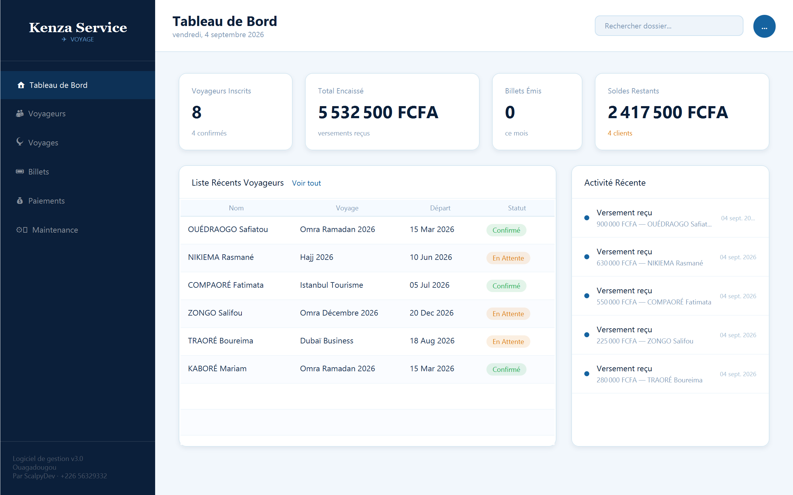 | 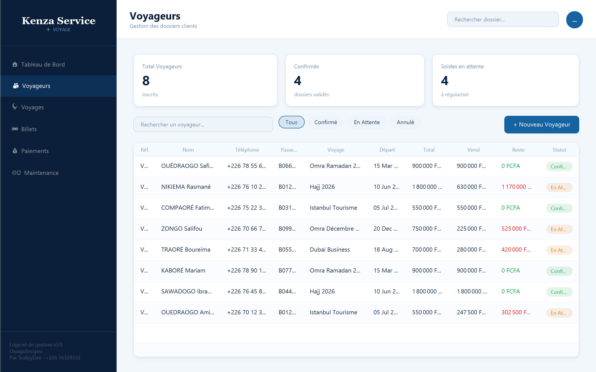 |

| Suivi des paiements | Billets |
|---|---|
| 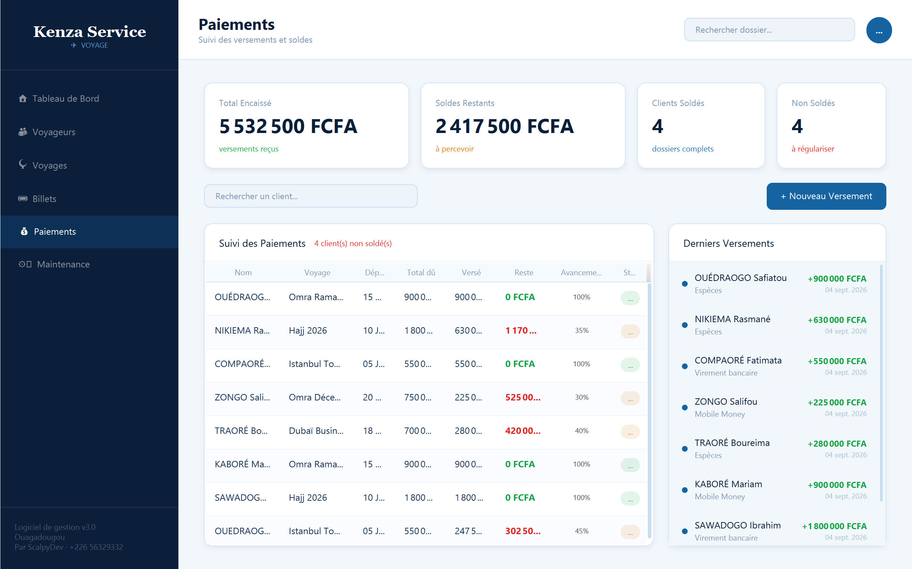 | 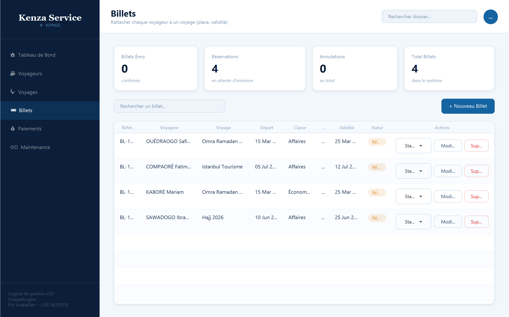 |

| Voyages & packages | Maintenance |
|---|---|
| 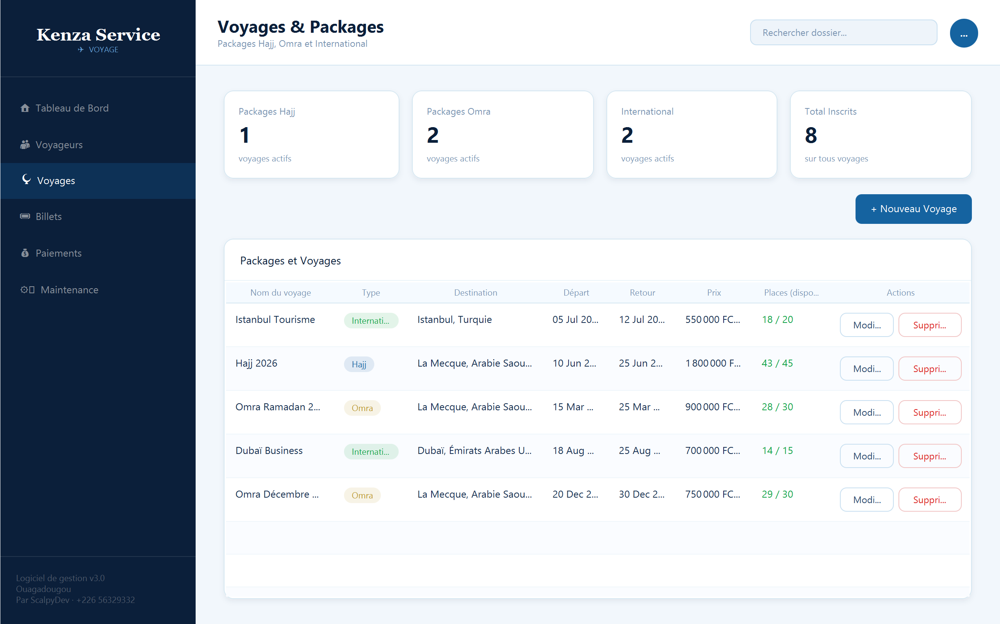 | 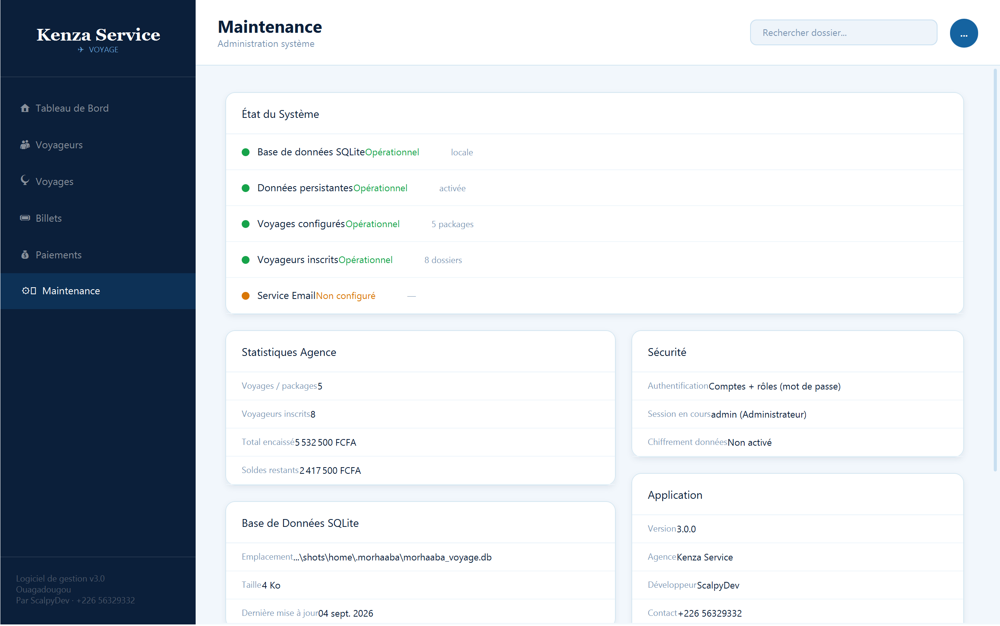 |

| Connexion | Reçu généré (PDF) |
|---|---|
| 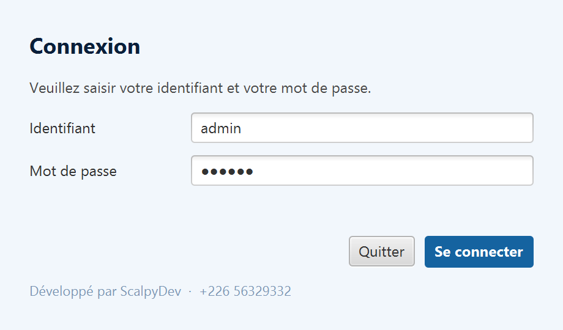 | 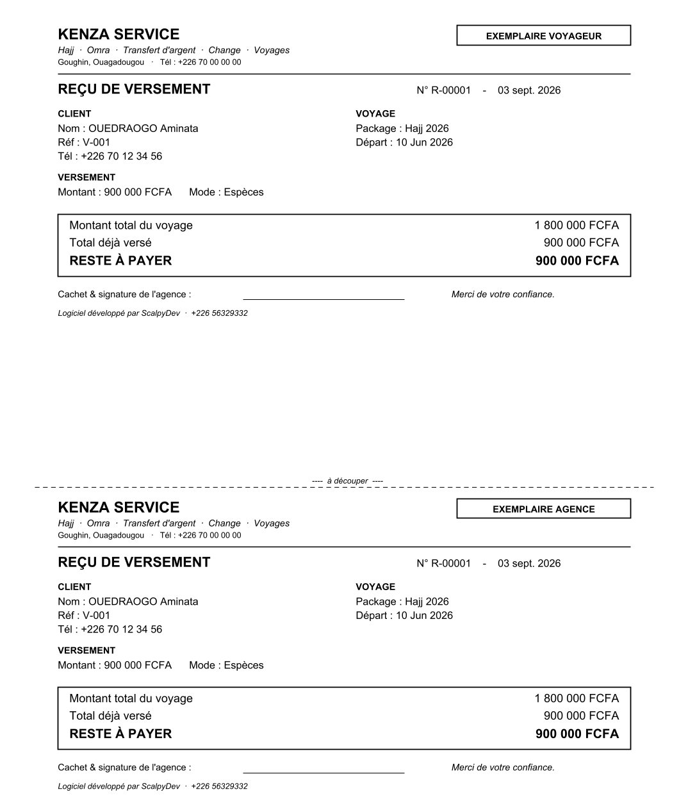 |

## 🏗️ Architecture & conception

Conception réalisée avec **UML** selon le processus **2TUP** (processus en Y). Architecture applicative en couches de type **MVC** (Modèle – Vue – Contrôleur + Services), pour une application de bureau mono-poste (**1-tier**).

Voir les diagrammes UML

**Processus 2TUP**
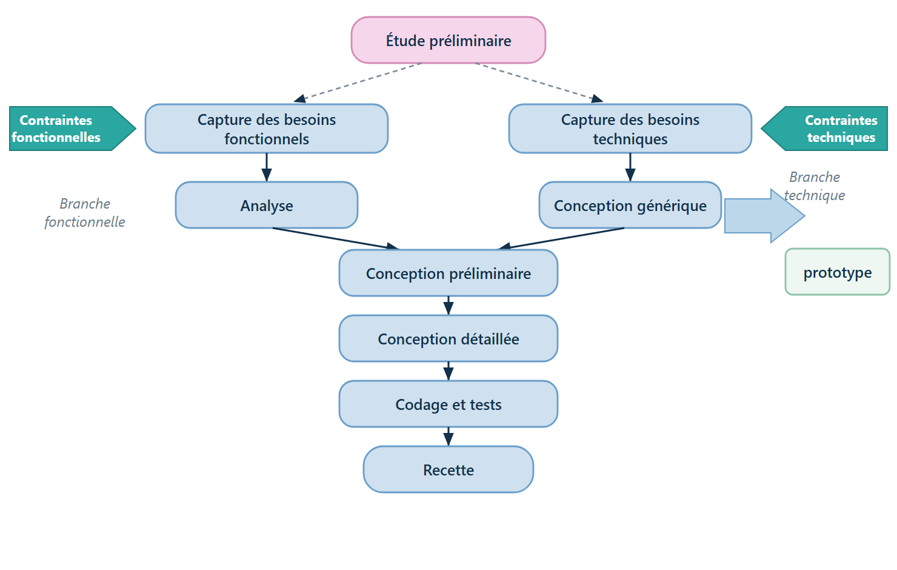

**Diagramme de cas d'utilisation**
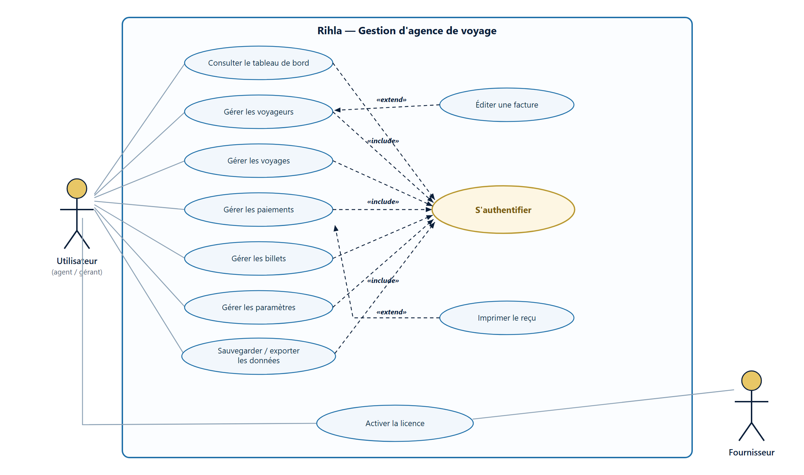

**Diagramme de classes**
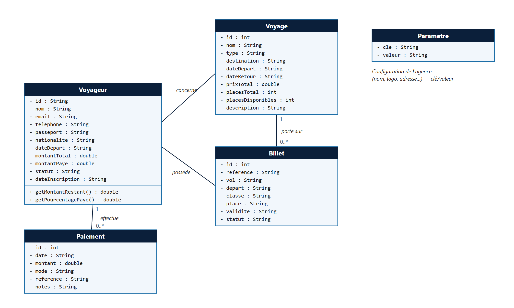

**Diagramme de séquence** (inscription + premier versement)
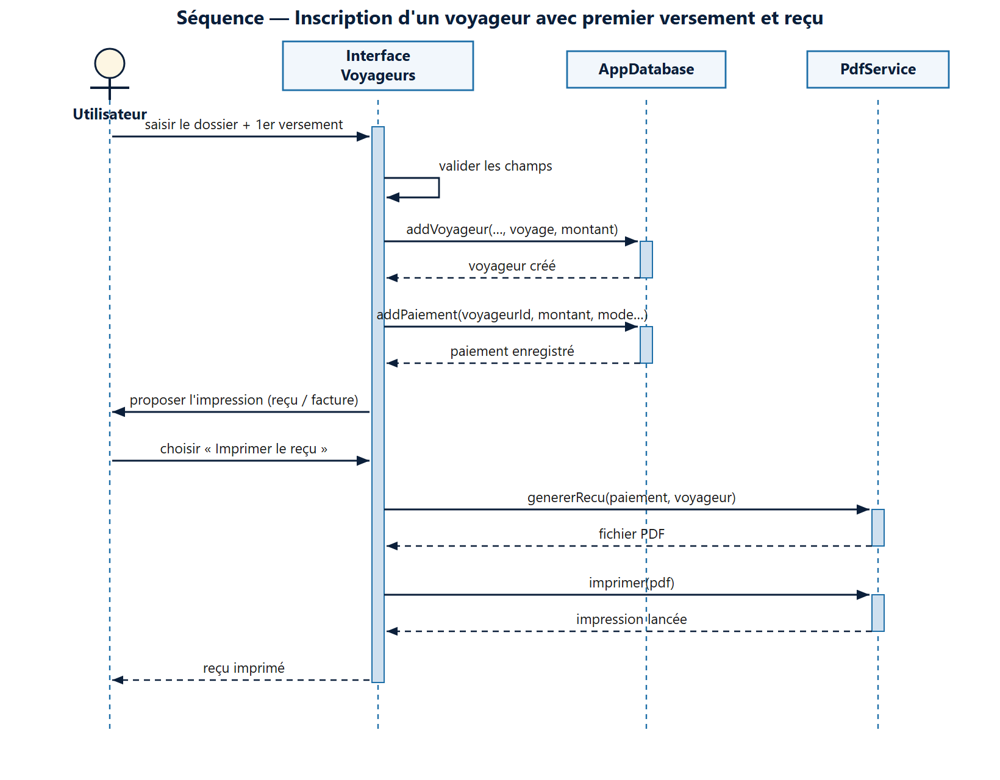

**Diagramme d'activité** (suivi des paiements)
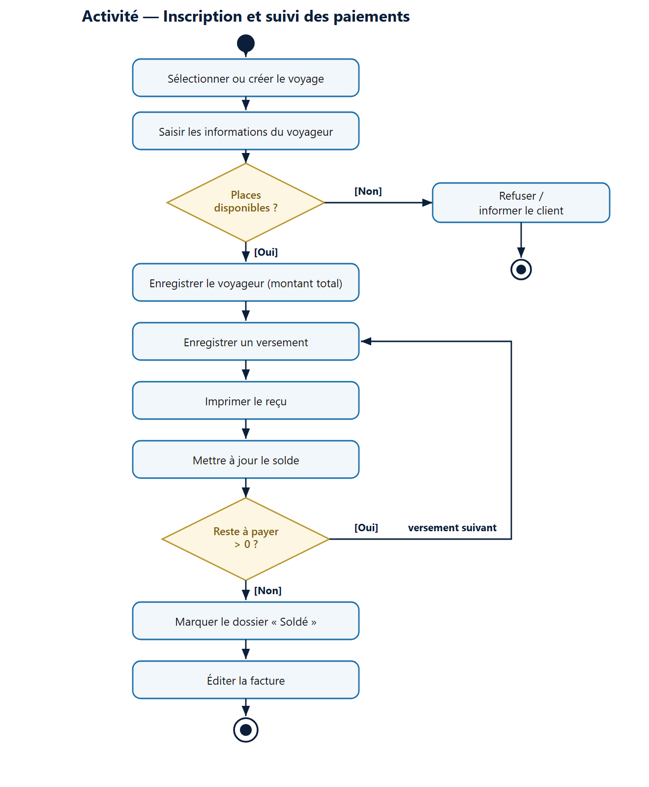

**Diagramme de déploiement**
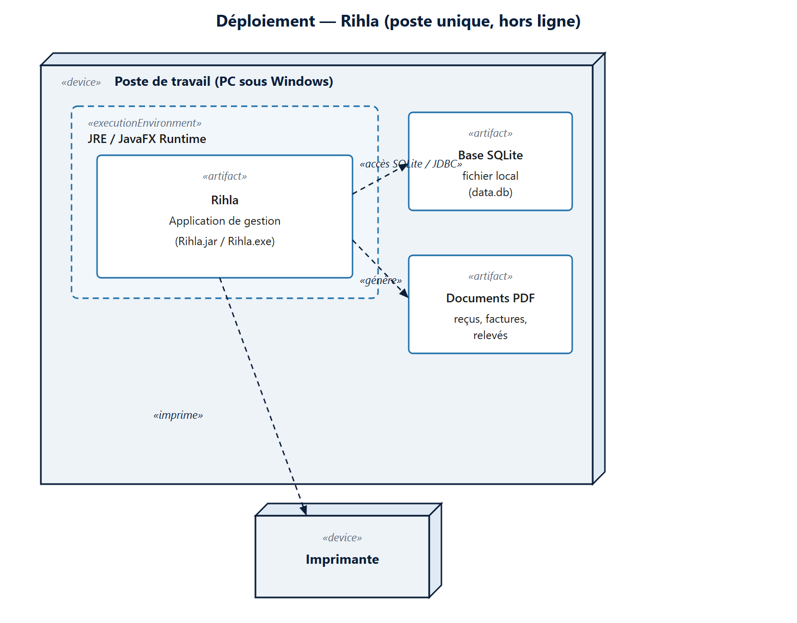

## 🛠️ Stack technique

| Domaine | Technologie |
|---|---|
| Langage | **Java 17** (LTS) |
| Interface graphique | **JavaFX 21** (FXML + CSS) |
| Base de données | **SQLite** (embarquée, hors ligne) |
| Génération PDF | **Apache PDFBox 3** |
| Build & dépendances | **Apache Maven** |
| Modélisation | **UML / PlantUML** (processus 2TUP) |
| Outils | IntelliJ IDEA, Scene Builder, DB Browser for SQLite, Git |
| Distribution | **jpackage** (exécutable Windows autonome) |

## 🔒 Sécurité

- **Authentification** par identifiant et mot de passe (empreinte **SHA-256 + sel**, jamais stocké en clair).
- **Protection contre la copie** : activation par **clé de licence signée (RSA)**, liée à l'empreinte de la machine.
- **Données locales** sauvegardables à tout moment.

## 📦 Statut

Application **en production**, installée et utilisée en conditions réelles par une agence à Ouagadougou. Projet propriétaire — le code source n'est pas distribué publiquement.

## 👤 Auteur

**YODA Bila Abdoul Aziz Clément** — *ScalpyDev*, développeur freelance (Ouagadougou, Burkina Faso).

- 📧 bilayoda40@gmail.com
- 💼 LinkedIn : [bila-yoda](https://www.linkedin.com/in/bila-yoda-32b79b375)

---

# English version

## Rihla — Travel Agency Management Software ✈️🕋

Desktop application (Java / JavaFX) for agencies specialized in **Hajj**, **Umrah** and **international travel**: management of travelers, packages, **installment payments**, tickets, and automatic generation of PDF documents (receipts, invoices, statements).

> ℹ️ **Showcase repository.** Rihla is a **proprietary product** sold under license, so the full source code is **not published** here. This repository presents the project, its features, architecture and screenshots (using **demo** data). A private demo is available **on request**.

### Context
Many travel agencies in Burkina Faso specialized in Hajj/Umrah still rely on manual management (notebooks, handwritten receipts, spreadsheets), which makes tracking **installment payments** error-prone and causes data loss and disputes. Rihla solves this with a simple, reliable, offline application that centralizes the agency's activity.

### Key features
- Dashboard with key indicators (travelers, collected amounts, outstanding balances).
- Traveler management (registration, search, filters, payment status).
- Travel packages (Hajj, Umrah, International): dates, prices, available seats.
- **Installment payment tracking** with automatic balance / amount-due computation.
- Ticket management (flight, class, seat, validity, status).
- Automatic **PDF** documents (receipts, invoices, statements) with the agency letterhead.
- Password authentication and **machine-locked license activation**.

### Tech stack
Java 17 · JavaFX 21 (FXML + CSS) · SQLite · Apache PDFBox 3 · Maven · UML/2TUP · MVC architecture · jpackage (standalone Windows executable).

### Author
**YODA Bila Abdoul Aziz Clément** — *ScalpyDev*, freelance developer (Ouagadougou, Burkina Faso). 📧 bilayoda40@gmail.com
